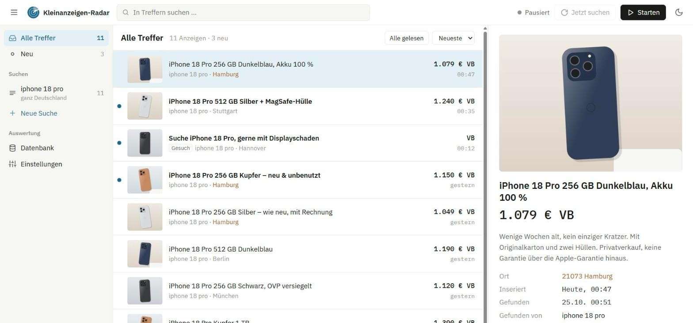
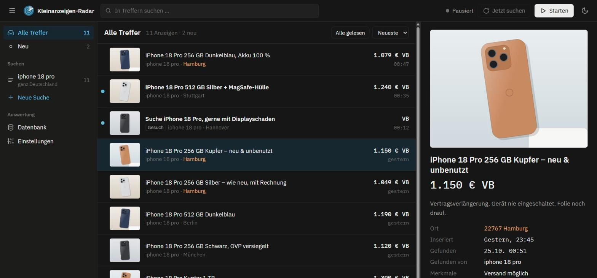
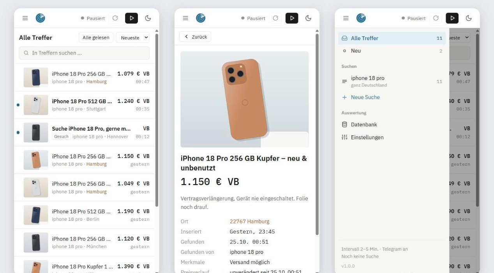
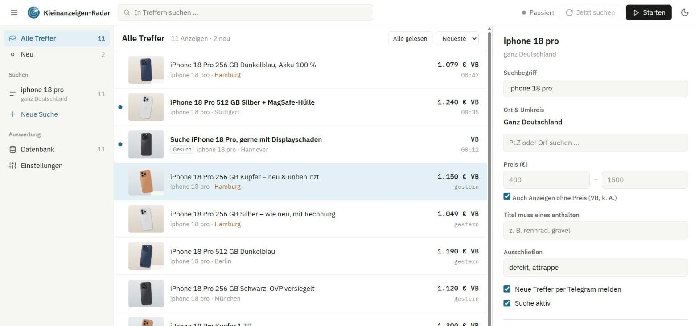
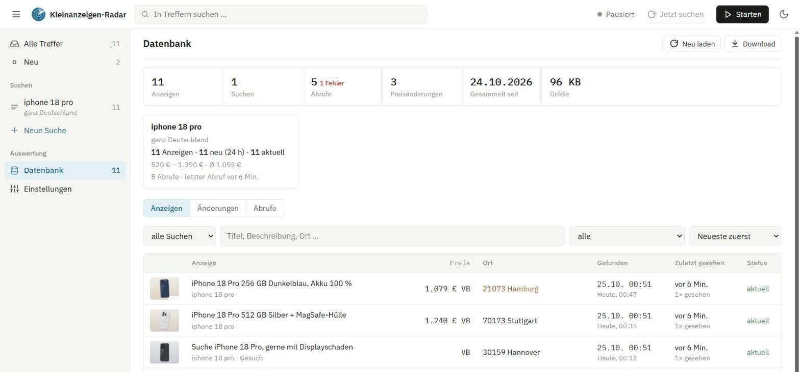

<div align="center">


# Kleinanzeigen-Radar

**Selbst gehosteter Monitor für Kleinanzeigen.de: meldet neue Anzeigen zu deinen Suchen sofort in der Weboberfläche und auf Wunsch per Telegram.**


[Funktionen](#funktionen) · [Schnellstart](#schnellstart) · [Konfiguration](#konfiguration) · [Nutzung](#nutzung) · [Hinweise](#wichtige-hinweise)

</div>

> **Inoffizielles Projekt.** Kleinanzeigen-Radar steht in keiner Verbindung zu Kleinanzeigen (ehemals eBay Kleinanzeigen) und wird von dort weder unterstützt noch geprüft. „Kleinanzeigen“ ist eine Marke ihres Inhabers und wird hier nur genannt, um zu beschreiben, mit welcher Website das Werkzeug zusammenarbeitet.



<details>
<summary><b>Weitere Screenshots</b> – Dunkelmodus, Smartphone, Such-Editor, Datenbank</summary>

**Dunkelmodus** – neue Anzeigen fett mit Punkt, Orte mit hervorgehobener PLZ farbig


**Smartphone** – Liste, Vorschau, Menü


**Suche bearbeiten** – Ort & Umkreis, Preis, Wortfilter, Telegram


**Datenbank** – alle jemals gefundenen Anzeigen, Änderungen und Abrufe


</details>

<sub>Die Screenshots zeigen erfundene Demodaten (`tools/demo_data.py`), keine echten Anzeigen.</sub>

---

## Funktionen

- **Suchbegriffe und Kategorien überwachen:** beliebig viele Suchen, jede einzeln an- und abschaltbar. Statt eines Begriffs geht auch jede Kleinanzeigen-URL, zum Beispiel eine Kategorie mit Filtern
- **Eigene Filter pro Suche:** Ort und Umkreis (Ortssuche nach PLZ oder Name), Preisbereich, Anzeigen ohne Preis ein- oder ausblenden, Pflicht- und Ausschlusswörter, Telegram an oder aus
- **Nur wirklich neue Anzeigen:** Der erste Durchlauf einer Suche liest den Bestand ein. Danach wird nur gemeldet, was neu dazukommt, ohne Telegram-Schwall. Alte, nachrutschende Anzeigen gelten nicht als neu
- **Oberfläche wie ein Mailprogramm:** Ordnerleiste (Alle Treffer, Neu, je Suche, Datenbank, Einstellungen) | Trefferliste | Vorschau mit großem Bild, Beschreibung und Preisverlauf. Ungelesene Anzeigen sind fett markiert, dazu Suchfeld, Preis-Sortierung, Tastatursteuerung, Hell- und Dunkelmodus
- **Smartphone-tauglich:** eine Spalte, Menü und Vorschau öffnen als eigene Ebenen
- **Telegram-Benachrichtigung:** Foto, Titel, Preis, Ort und Link zu jeder neuen Anzeige (optional)
- **Zufälliges Abrufintervall** (z. B. 2–5 Minuten) mit Countdown und „Jetzt suchen“
- **Globale Blacklist** für Titelwörter, „Gesuch“-Anzeigen ausblenden
- **Orte hervorheben:** Postleitzahlen mit bestimmten Anfängen (z. B. `20, 22`) farbig markieren
- **Such-Sets:** Suchen samt Einstellungen speichern und mit einem Klick laden
- **Parser-Wächter:** warnt in der Oberfläche und per Telegram, wenn Suchen plötzlich nichts mehr finden (etwa weil Kleinanzeigen den Seitenaufbau geändert hat) oder dauerhaft fehlschlagen
- **Suchverlauf in SQLite:** Alle Treffer werden ungefiltert und dauerhaft gespeichert, inklusive Preis- und Textänderungen. Auswertbar direkt in der App (Ansicht „Datenbank“) oder mit jedem SQLite-Werkzeug
- **Schonender Abruf:** Pausen zwischen den Suchen, Wiederholungen bei Fehlern, automatisch 15 Minuten Pause, wenn Kleinanzeigen Anfragen abweist
- **Keine Abhängigkeiten:** nur die Python-Standardbibliothek, läuft lokal oder im Docker-Container

## Schnellstart

### Lokal mit Python

Voraussetzung: Python 3.10 oder neuer, keine weiteren Pakete nötig.

```bash
git clone https://github.com/rofldark/kleinanzeigen-radar.git
cd kleinanzeigen-radar
python main.py
```

Danach http://localhost:8080 im Browser öffnen.

### Mit Docker

Voraussetzung: Docker mit Compose.

```bash
git clone https://github.com/rofldark/kleinanzeigen-radar.git
cd kleinanzeigen-radar
docker compose up -d --build
```

Die Weboberfläche läuft dann auf Port 8080 des Rechners (anpassbar in `docker-compose.yml`). Einstellungen und Verlauf liegen in `./data` und bleiben bei Updates erhalten. Nach einem `git pull` genügt erneut `docker compose up -d --build`.

## Konfiguration

Fast alles (Suchen, Filter, Intervall, Blacklist …) wird in der Weboberfläche eingestellt und in `data/state.json` gespeichert.

Technische Werte und die Telegram-Zugangsdaten kommen aus Umgebungsvariablen. Am einfachsten kopierst du dazu die Vorlage `.env.example` nach `.env` und trägst deine Werte ein. Die `.env` wird beim lokalen Start und von Docker Compose gelesen und ist per `.gitignore` vom Repository ausgeschlossen:

```bash
cp .env.example .env
```

```ini
TELEGRAM_TOKEN=123456789:AA...
TELEGRAM_CHAT_ID=123456789
```

| Variable | Beschreibung | Standard |
|---|---|---|
| `TELEGRAM_TOKEN` | Token des Telegram-Bots (vom [@BotFather](https://t.me/BotFather)) | leer = kein Telegram |
| `TELEGRAM_CHAT_ID` | Chat, in den gemeldet wird (eigene ID z. B. über [@userinfobot](https://t.me/userinfobot)) | leer = kein Telegram |
| `PORT` | Port der Weboberfläche | `8080` |
| `DATA_DIR` | Ablage der Daten | `./data` bzw. `/data` im Container |
| `MAX_TELEGRAM_PER_RUN` | Telegram-Meldungen pro Suchlauf | `10` |
| `MAX_LISTINGS` | Anzeigen in der Trefferliste | `600` |
| `MIN_INTERVAL` | kürzestes erlaubtes Intervall in Sekunden | `30` |
| `MAX_AGE_DAYS` | ältere Anzeigen gelten nie als neu | `2` |
| `WATCHDOG_EMPTY_RUNS` / `WATCHDOG_ERROR_RUNS` | Leer- bzw. Fehlläufe in Folge bis zur Warnung | `2` / `3` |

Ohne Telegram-Daten läuft die App normal, verschickt aber keine Nachrichten. Ob alles klappt, zeigt **Einstellungen → Telegram → Testnachricht senden**.

## Nutzung

1. Links **+ Neue Suche**: Suchbegriff mit Ort, Umkreis, Preis und Wortfiltern anlegen, oder eine Kleinanzeigen-URL einfügen.
2. **Starten** in der Kopfzeile. Der erste Durchlauf einer Suche liest den Bestand ein, auch nach einer Änderung von Ort oder Preis.
3. Neue Anzeigen erscheinen fett mit Punkt (und per Telegram). Anklicken öffnet die Vorschau und markiert sie als gelesen, **Alle gelesen** markiert alles.
4. Eine Suche links anklicken zeigt nur ihre Treffer, **✎** öffnet ihre Einstellungen. Das Menü-Symbol oben links klappt die Ordnerleiste ein und aus.
5. Intervall, Blacklist, hervorgehobene Orte, Telegram und Such-Sets stehen unter **Einstellungen**.

Die Überwachung merkt sich ihren Zustand: Nach einem Neustart läuft sie einfach weiter, ohne bekannte Anzeigen erneut zu melden.

### Suchverlauf auswerten

Am einfachsten über **Datenbank** in der Ordnerleiste: Kennzahlen je Suche, alle jemals gefundenen Anzeigen mit Filter und Sortierung, Änderungen (z. B. Preissenkungen) und Abrufe. Dort gibt es auch den Download der Datenbank (konsistente Kopie im laufenden Betrieb).

`data/history.db` ist eine normale SQLite-Datei, lesbar z. B. mit „DB Browser for SQLite“ oder `sqlite3`. Zeitstempel sind Unix-Sekunden.

| Tabelle | Inhalt |
|---|---|
| `searches` | jede Suche mit Begriff/URL, Ort, Umkreis, Preisbereich |
| `listings` | jede Anzeige einmal mit letztem Stand, zuerst/zuletzt gesehen, Anzahl Sichtungen |
| `listing_searches` | welche Suche welche Anzeige wann gefunden hat |
| `listing_changes` | Änderungen an Preis, Titel, Beschreibung, Ort … |
| `runs` | jeder Abruf einer Suche mit Trefferzahl bzw. Fehler |

Beispiel: Anzeigen einer Suche mit ihrer Laufzeit:

```sql
SELECT l.title, l.price, datetime(ls.first_seen, 'unixepoch', 'localtime') AS gefunden,
       round((ls.last_seen - ls.first_seen) / 3600.0, 1) AS stunden_sichtbar
FROM listing_searches ls JOIN listings l ON l.id = ls.listing_id
JOIN searches s ON s.id = ls.search_id
WHERE s.name = 'fahrrad' ORDER BY ls.first_seen DESC;
```

## Wichtige Hinweise

- **Nutzung auf eigene Verantwortung.** Das Werkzeug ruft öffentliche Suchergebnisseiten von Kleinanzeigen.de ab. Beachte die Nutzungsbedingungen von Kleinanzeigen und nutze es nur für private Zwecke, in Maßen und mit vernünftigen Intervallen. Die Voreinstellungen sind bewusst zurückhaltend gewählt.
- **Keine Anmeldung.** Die Weboberfläche hat keinen Zugangsschutz. Betreibe sie nur im eigenen Netz und stelle sie nicht offen ins Internet.
- **Nur die erste Ergebnisseite** (ca. 25 Anzeigen, neueste zuerst) wird je Suche gelesen. Bei sehr vielen neuen Anzeigen zwischen zwei Abrufen kann etwas durchrutschen, dann das Intervall verkürzen oder die Suche enger fassen.
- **Seitenaufbau kann sich ändern.** Baut Kleinanzeigen die Ergebnisseiten um, findet der Parser eventuell nichts mehr. Der Parser-Wächter meldet das, eine Anpassung in `app/scraper.py` ist dann nötig.

## Projektstruktur

```
main.py                  Start: Speicher laden, Überwachung starten, Webserver
app/
  config.py              Einstellungen aus Umgebungsvariablen bzw. .env
  scraper.py             Such-URLs, Abruf, Parser für Ergebnisseiten
  monitor.py             Hintergrund-Überwachung, Filter, Parser-Wächter, Telegram-Versand
  store.py               Einstellungen und Trefferliste (data/state.json)
  history.py             Suchverlauf (data/history.db, SQLite)
  telegram.py            Telegram-Bot-API
  server.py              HTTP-Server und JSON-API
static/                  Weboberfläche (HTML, CSS, Vanilla JS, Logo als SVG)
tests/                   Unit-Tests mit gekürzten, anonymisierten Ergebnisseiten
tools/demo_data.py       erfundene Demodaten für die Screenshots
docs/screenshots/        Screenshots für diese README
Dockerfile, docker-compose.yml
```

## Tests

```bash
python -m unittest discover -s tests -t .
node --check static/app.js     # optional: JS-Syntax prüfen
```

Die Tests verschicken nie echte Telegram-Nachrichten, auch wenn eine `.env` mit Zugangsdaten vorhanden ist.

## Lizenz

[MIT](LICENSE). Änderungen stehen im [CHANGELOG](CHANGELOG.md).
